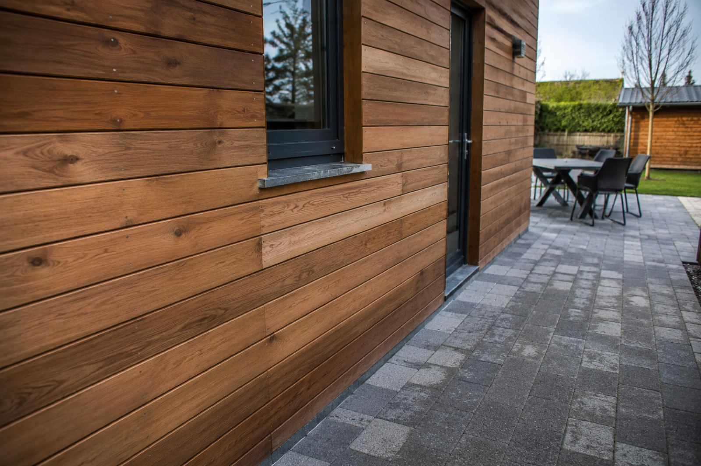

# Images adaptées à la largeur d’écran

`build-images.py` produit les variantes WebP des photographies déjà présentes dans `assets/img/realisations/`. Les fichiers sources sont conservés. Aucun recadrage, agrandissement ou contenu généré n’est appliqué.

## Régénération

Avec Python 3.9+ et Pillow 11.3.0 installé dans un environnement isolé :

```sh
python scripts/build-images.py
python scripts/build-images.py --verify
```

La génération ne fait pas partie du build Vercel : les variantes et leur manifeste sont versionnés, et le build statique copie le dossier `assets` existant. Le déploiement n’a donc besoin ni de Python ni de Pillow.

Les largeurs cibles sont 480, 768 et 1200 pixels, sans dépasser la source. Les petites photos existantes gardent leur définition native. Le candidat natif est conservé jusqu’à 1600 pixels. Si une recompression à la même largeur n’économise pas au moins 5 %, le fichier WebP existant est réutilisé.

Les dérivés utilisent le redimensionnement Lanczos et WebP qualité 80 / méthode 6. Ils partent du JPEG existant lorsqu’il possède les mêmes dimensions, afin d’éviter une nouvelle génération à partir d’un WebP déjà compressé. Les métadonnées EXIF ne sont pas recopiées.

## Intégration HTML

Le fichier `assets/img/responsive/manifest.json` expose un dictionnaire `images` dont chaque clé est l’URL WebP existante. Chaque entrée contient `srcset`, les dimensions et tailles des variantes, les empreintes SHA-256 des sources et un indicateur `small_source`.

```html
<picture>
  <source type="image/webp"
          srcset="/assets/img/responsive/bardage-bois-terrasse-480.webp 480w,
                  /assets/img/responsive/bardage-bois-terrasse-768.webp 768w,
                  /assets/img/responsive/bardage-bois-terrasse-1200.webp 1200w,
                  /assets/img/realisations/bardage-bois-terrasse.webp 1600w"
          sizes="(min-width: 1024px) 50vw, 100vw">
  
</picture>
```

Adapter `sizes` à la largeur réellement affichée dans chaque mise en page. Conserver les dimensions de l’image et les choix `loading` / `fetchpriority` appropriés. Une photo de carte n’a généralement pas les mêmes `sizes` qu’une photo principale.

Les poids du manifeste décrivent les fichiers, pas une mesure de transfert initial ni un gain de Core Web Vitals. Les images de source 320 pixels ne doivent pas être utilisées en grand visuel : elles demandent des photographies originales de meilleure définition, sans agrandissement artificiel.

## AVIF du visuel principal

Le bardage bois possède également des variantes AVIF de 480, 768 et 1200 pixels :

```sh
python scripts/build-images.py --avif-hero
python scripts/build-images.py --avif-hero --verify
```

Cette option ne régénère et ne modifie aucun WebP. Elle écrit `assets/img/responsive/manifest-avif.json`, avec la même clé d’image que le manifeste WebP. Ajouter le `<source type="image/avif">` avant le `<source type="image/webp">` et conserver les mêmes `sizes` ainsi que le fallback JPEG.

L’encodage retenu est AVIF qualité 60, vitesse 5, sous-échantillonnage 4:2:0, deux threads, depuis le JPEG original. Les qualités 55, 60 et 65 ont été comparées visuellement sur les détails du bois et des pavés. La qualité 60 conserve un bon niveau de détail ; 55 lisse davantage le bois, tandis que 65 offre un gain de poids plus faible par rapport au WebP.

| Largeur | WebP existant | AVIF qualité 60 | Réduction |
|---|---:|---:|---:|
| 480 | 25 792 octets | 20 823 octets | 19,3 % |
| 768 | 56 330 octets | 45 165 octets | 19,8 % |
| 1200 | 113 958 octets | 85 639 octets | 24,8 % |

Ces gains de transfert potentiels ne constituent pas une mesure du LCP. La nouvelle source doit être vérifiée dans le navigateur et sur le déploiement final.
